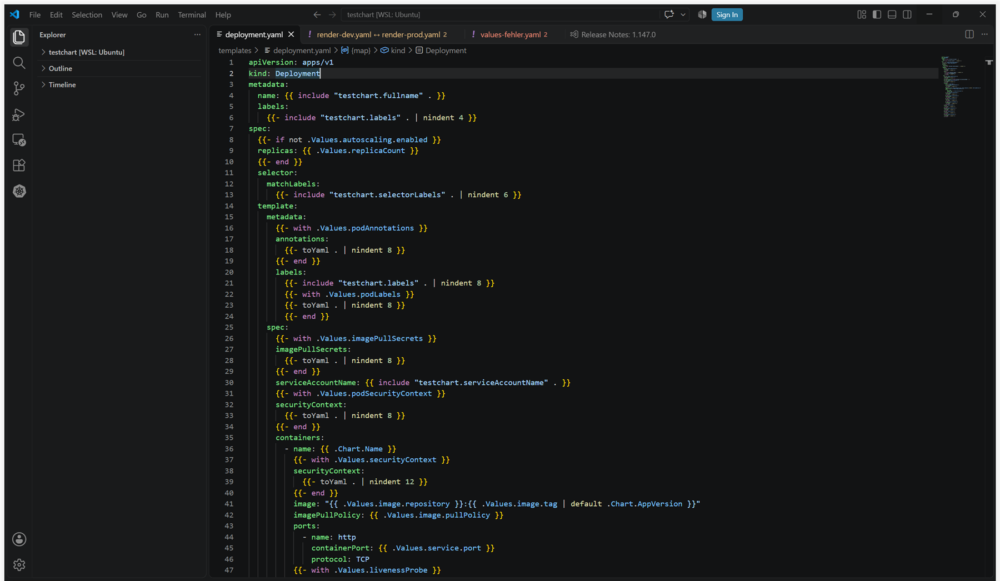
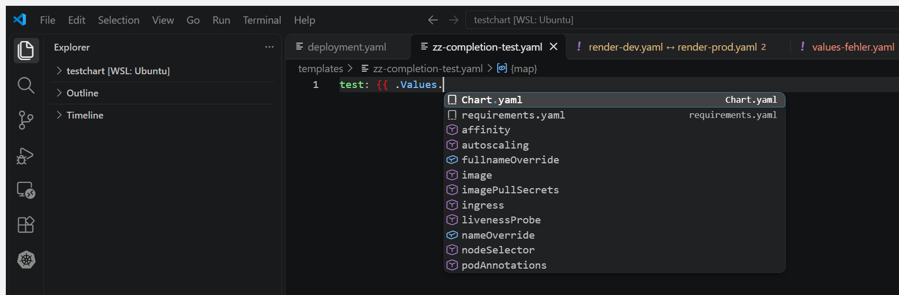
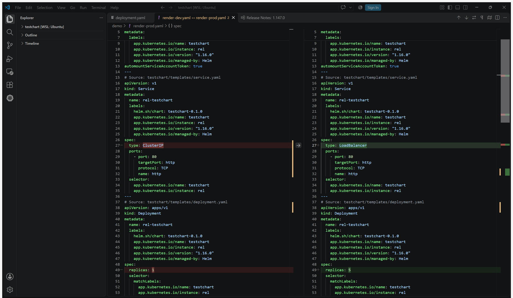

# Helm in Visual Studio Code

## Empfohlene Extensions

| Extension | ID | Wofür |
|---|---|---|
| Kubernetes | `ms-kubernetes-tools.vscode-kubernetes-tools` | Cluster-Explorer, Logs; bringt den Language-Mode `helm` für `templates/` mit |
| YAML | `redhat.vscode-yaml` | Validierung und Schemas für YAML |
| Helm Intellisense | `Tim-Koehler.helm-intellisense` | Vervollständigung für `.Values.*` aus der `values.yaml` |
| Remote - SSH / WSL | `ms-vscode-remote.remote-ssh`, `ms-vscode-remote.remote-wsl` | Arbeiten direkt auf Bastion bzw. in WSL |

Installation (Extensions müssen bei Remote-Nutzung auch auf der Remote-Seite installiert sein):

```bash
code --install-extension ms-kubernetes-tools.vscode-kubernetes-tools
code --install-extension redhat.vscode-yaml
code --install-extension Tim-Koehler.helm-intellisense
```

## Wichtig: Ordner als vertrauenswürdig markieren (Workspace Trust)

Beim ersten Öffnen eines Ordners zeigt VS Code oben den Hinweis **Restricted Mode**.
Solange der Ordner nicht vertraut ist, bleiben die Extensions (Kubernetes, YAML,
Helm Intellisense) **inaktiv**: kein Syntax-Highlighting und keine Vervollständigung.

1. Oben auf **Manage** -> **Trust** klicken (oder `Strg+Shift+P` -> *Workspaces: Manage Workspace Trust*).
2. Danach `Strg+Shift+P` -> **Developer: Reload Window**.

Erst danach funktionieren Highlighting und die Prüfung der Templates.

## Problem: rote Fehler in templates/ (False Positive)

Symptom: In `templates/*.yaml` meldet die YAML-Extension z. B.
`All mapping items must start at the same column` bei `{{- end }}` oder `{{ .Values... }}`.

Ursache: Dateien in `templates/` sind Go-Templates, kein reines YAML. Wird die Datei im
Language-Mode **YAML** geöffnet, hält die YAML-Extension die Template-Zeilen für Fehler.
`helm lint` meldet dabei keinen Fehler - das Chart ist in Ordnung.

Lösung: Language-Mode **Helm** verwenden.

1. Statusleiste rechts unten auf die Sprache klicken und **Helm** wählen, oder
2. dauerhaft pro Projekt in `.vscode/settings.json`:

```json
{
  "files.associations": {
    "**/templates/*.yaml": "helm",
    "**/templates/*.yml": "helm",
    "**/templates/*.tpl": "helm",
    "**/templates/*.txt": "helm"
  }
}
```

Danach ggf. `Strg+Shift+P` -> **Developer: Reload Window**.

## Was man in VS Code mit Helm machen kann

Alle Beispiele nutzen das Chart, das `helm create testchart` erzeugt. Die Screenshots
stammen aus VS Code mit Remote - WSL.

### 1. Templates lesen: Syntax-Highlighting

Im Language-Mode **Helm** (Statusleiste unten rechts: `helm-template`) werden die
Go-Template-Teile vom YAML getrennt eingefärbt:

- `{{` und `}}` sowie Schlüsselwörter wie `include`, `if`, `with`, `end` sind abgesetzt,
- `.Values.…` und `.Chart.…` erkennt man auf einen Blick,
- Pipes und Sprig-Funktionen wie `nindent` oder `toYaml` sind eigene Farben,
- die Breadcrumb-Leiste oben zeigt, wo man sich im YAML befindet (`kind > Deployment`).

Der Nutzen: Man sieht sofort, welche Zeilen vom Chart erzeugt werden und welche feste
Manifest-Struktur sind. Das hilft vor allem beim Verstehen fremder Charts.



*Voraussetzung: Ordner ist vertrauenswürdig (siehe oben), sonst bleibt der Editor einfarbig.*

### 2. Werte vervollständigen: Helm Intellisense

Tippt man in einem Template `{{ .Values.`, schlägt Helm Intellisense die Schlüssel aus der
`values.yaml` des Charts vor (hier `affinity`, `autoscaling`, `image`, `ingress`, …).
Die Liste lässt sich auch mit `Strg+Leertaste` aufrufen.

Der Nutzen: Man schreibt keine Tippfehler in Wertnamen und muss die `values.yaml` nicht
ständig daneben offen haben.

Hinweis: Oben in der Liste stehen zusätzlich Dateien wie `Chart.yaml`. Das sind
Datei-Vorschläge und keine Werte.



### 3. Auswirkungen von values vergleichen: Dev gegen Prod

Die wichtigste Frage bei Helm lautet: Was ändert sich im fertigen Manifest, wenn ich andere
Werte übergebe? Dazu rendert man das Chart zweimal und vergleicht die Ergebnisse
nebeneinander. Als Beispiel dient ein Chart aus `helm create testchart`. Im Chart-Verzeichnis
legt man zusätzlich eine Datei `values-prod.yaml` an, die nur die abweichenden Werte enthält:

```yaml
# values-prod.yaml
replicaCount: 5
image:
  tag: "1.27.0"
service:
  type: LoadBalancer
resources:
  limits:
    cpu: 500m
    memory: 256Mi
```

Dann rendert man beide Varianten und öffnet den Vergleich:

```bash
mkdir -p demo
helm template rel . > demo/render-dev.yaml
helm template rel . -f values-prod.yaml > demo/render-prod.yaml
code --diff demo/render-dev.yaml demo/render-prod.yaml
```

Im Screenshot sieht man links Dev, rechts Prod. Die Unterschiede sind farbig markiert:
`type: ClusterIP` wird zu `LoadBalancer`, `replicas: 1` zu `5`. Weiter unten im selben
Vergleich stehen die geänderte Image-Version und die neuen `resources`.

Der Nutzen: Man prüft Änderungen vor dem Rollout, ohne einen Cluster zu brauchen.
Das Plugin `helm diff` vergleicht dagegen gegen einen laufenden Release und ersetzt dieses
Vorgehen nicht; der lokale Vergleich ist aber sofort und ohne Cluster verfügbar.



### 4. Fehler in values früh erkennen: values.schema.json

Legt man im Chart eine `values.schema.json` an, prüft Helm damit die Werte, und VS Code
zeigt Verstöße schon beim Tippen an. Das Schema (im Chart-Verzeichnis neben `values.yaml`):

```json
{
  "$schema": "http://json-schema.org/draft-07/schema#",
  "type": "object",
  "properties": {
    "replicaCount": { "type": "integer", "minimum": 1 },
    "image": { "type": "object", "properties": { "tag": { "type": "string" } } },
    "service": {
      "type": "object",
      "properties": { "type": { "enum": ["ClusterIP", "NodePort", "LoadBalancer"] } }
    }
  }
}
```

Damit VS Code das Schema für eine Values-Datei verwendet, steht oben in der Datei eine Zeile
für die YAML-Extension (der Pfad ist relativ zur jeweiligen Datei). Als Beispiel eine Datei
`demo/values-fehler.yaml` mit zwei absichtlichen Fehlern:

```yaml
# yaml-language-server: $schema=../values.schema.json
replicaCount: "fuenf"        # Fehler: erwartet wird eine Zahl
service:
  type: Loadbalancer         # Fehler: erlaubt sind ClusterIP, NodePort, LoadBalancer
```

Im Screenshot sind die beiden falschen Werte rot unterwellt. Dieselben Fehler fängt auch
Helm selbst ab, bevor etwas deployt wird (Helm liest `values.schema.json` automatisch):

```
$ helm lint . -f demo/values-fehler.yaml        # Auszug
[ERROR] values.yaml: - replicaCount: Invalid type. Expected: integer, given: string
- service.type: service.type must be one of the following: "ClusterIP", "NodePort", "LoadBalancer"
```

Der Nutzen: Tippfehler und falsche Typen fallen im Editor auf und nicht erst bei
`helm install`. Das Schema dient zugleich als Dokumentation der erlaubten Werte.


### 5. Kubernetes-Extension: Cluster und Helm-Repos ansehen

Die Kubernetes-Extension legt links in der Seitenleiste ein eigenes Symbol (Steuerrad) an.
Die Ansicht hat drei Bereiche:

- **Clusters:** alle Kontexte aus der Kubeconfig. Aufklappen zeigt Namespaces, Workloads usw.
- **Helm Repos:** die Repos aus `helm repo list` (z. B. `traefik`, `jetstack`, `hashicorp`).
  Aufklappen zeigt die Charts des Repos.
- **Clouds:** Anbindung an Cloud-Anbieter (ohne Registrierung leer).

Die Ansicht öffnet man über das Steuerrad-Symbol oder per `Strg+Shift+P` ->
*Kubernetes: Focus on Helm Repos View*.

Der Nutzen: Man sieht Cluster und verfügbare Charts, ohne `kubectl get` und `helm search`
im Terminal zu tippen. Aufgeklappt haben wir nur die Listen der Cluster und der Repos; die
Inhalte darunter wurden nicht ausprobiert. Einen Screenshot gibt es hier bewusst nicht,
weil die Cluster-Liste echte Kontextnamen zeigt.

## Prüfen im Terminal

```bash
helm lint .                                   # Struktur und Schema prüfen
helm lint . -f values-prod.yaml               # mit anderen Werten
helm template mein-release . -f values.yaml   # fertiges YAML ansehen
```

Das integrierte Terminal (Menü *Terminal* -> *New Terminal*) läuft bei Remote-Nutzung auf der
Remote-Maschine (WSL oder Bastion). Dort müssen `helm` und `kubectl` installiert sein.
