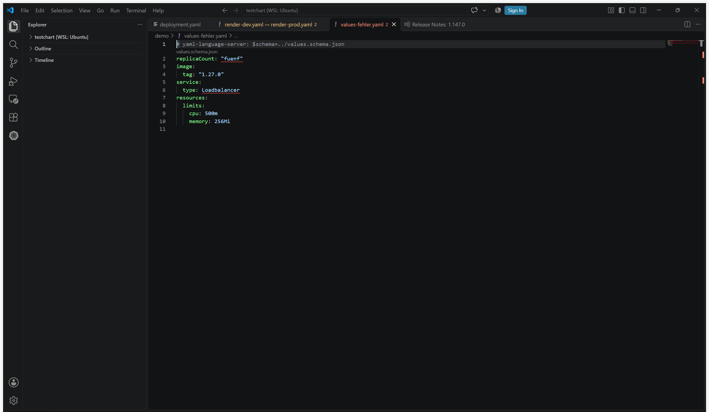

# Helm in Visual Studio Code

## Empfohlene Extensions

| Extension | ID | Wofür |
|---|---|---|
| Kubernetes | `ms-kubernetes-tools.vscode-kubernetes-tools` | Cluster-Explorer, Logs; bringt den Language-Mode `helm` für `templates/` mit |
| YAML | `redhat.vscode-yaml` | Validierung und Schemas für YAML |
| Helm Intellisense | `Tim-Koehler.helm-intellisense` | Vervollständigung für `.Values.*` aus der `values.yaml` |
| Remote - SSH / WSL | `ms-vscode-remote.remote-ssh`, `ms-vscode-remote.remote-wsl` | Arbeiten direkt auf Bastion bzw. in WSL |

Installation (Extensions müssen bei Remote-Nutzung auch auf der Remote-Seite installiert sein):

```bash
code --install-extension ms-kubernetes-tools.vscode-kubernetes-tools
code --install-extension redhat.vscode-yaml
code --install-extension Tim-Koehler.helm-intellisense
```

## Wichtig: Ordner als vertrauenswürdig markieren (Workspace Trust)

Beim ersten Öffnen eines Ordners zeigt VS Code oben den Hinweis **Restricted Mode**.
Solange der Ordner nicht vertraut ist, bleiben die Extensions (Kubernetes, YAML,
Helm Intellisense) **inaktiv**: kein Syntax-Highlighting und keine Vervollständigung.

1. Oben auf **Manage** -> **Trust** klicken (oder `Strg+Shift+P` -> *Workspaces: Manage Workspace Trust*).
2. Danach `Strg+Shift+P` -> **Developer: Reload Window**.

Erst danach funktionieren Highlighting und die Prüfung der Templates.

## Problem: rote Fehler in templates/ (False Positive)

Symptom: In `templates/*.yaml` meldet die YAML-Extension z. B.
`All mapping items must start at the same column` bei `{{- end }}` oder `{{ .Values... }}`.

Ursache: Dateien in `templates/` sind Go-Templates, kein reines YAML. Wird die Datei im
Language-Mode **YAML** geöffnet, hält die YAML-Extension die Template-Zeilen für Fehler.
`helm lint` meldet dabei keinen Fehler - das Chart ist in Ordnung.

Lösung: Language-Mode **Helm** verwenden.

1. Statusleiste rechts unten auf die Sprache klicken und **Helm** wählen, oder
2. dauerhaft pro Projekt in `.vscode/settings.json`:

```json
{
  "files.associations": {
    "**/templates/*.yaml": "helm",
    "**/templates/*.yml": "helm",
    "**/templates/*.tpl": "helm",
    "**/templates/*.txt": "helm"
  }
}
```

Danach ggf. `Strg+Shift+P` -> **Developer: Reload Window**.

## Was man in VS Code mit Helm machen kann

Alle Beispiele nutzen das Chart, das `helm create testchart` erzeugt. Die Screenshots
stammen aus VS Code mit Remote - WSL.

### 1. Templates lesen: Syntax-Highlighting

Im Language-Mode **Helm** (Statusleiste unten rechts: `helm-template`) werden die
Go-Template-Teile vom YAML getrennt eingefärbt:

- `{{` und `}}` sowie Schlüsselwörter wie `include`, `if`, `with`, `end` sind abgesetzt,
- `.Values.…` und `.Chart.…` erkennt man auf einen Blick,
- Pipes und Sprig-Funktionen wie `nindent` oder `toYaml` sind eigene Farben,
- die Breadcrumb-Leiste oben zeigt, wo man sich im YAML befindet (`kind > Deployment`).

Der Nutzen: Man sieht sofort, welche Zeilen vom Chart erzeugt werden und welche feste
Manifest-Struktur sind. Das hilft vor allem beim Verstehen fremder Charts.


*Voraussetzung: Ordner ist vertrauenswürdig (siehe oben), sonst bleibt der Editor einfarbig.*

### 2. Auswirkungen von values vergleichen: Dev gegen Prod

Die wichtigste Frage bei Helm lautet: Was ändert sich im fertigen Manifest, wenn ich andere
Werte übergebe? Dazu rendert man das Chart zweimal und vergleicht die Ergebnisse
nebeneinander:

```bash
helm template rel . > demo/render-dev.yaml
helm template rel . -f values-prod.yaml > demo/render-prod.yaml
code --diff demo/render-dev.yaml demo/render-prod.yaml
```

Im Screenshot sieht man links Dev, rechts Prod. Die Unterschiede sind farbig markiert:
`type: ClusterIP` wird zu `LoadBalancer`, `replicas: 1` zu `5`. Weiter unten im selben
Vergleich stehen die geänderte Image-Version und die neuen `resources`.

Der Nutzen: Man prüft Änderungen vor dem Rollout, ohne einen Cluster zu brauchen.
Das Plugin `helm diff` vergleicht dagegen gegen einen laufenden Release und ersetzt dieses
Vorgehen nicht; der lokale Vergleich ist aber sofort und ohne Cluster verfügbar.


### 3. Fehler in values früh erkennen: values.schema.json

Legt man im Chart eine `values.schema.json` an, prüft Helm damit die Werte, und VS Code
zeigt Verstöße schon beim Tippen an. Dazu kommt oben in die Values-Datei eine Zeile für die
YAML-Extension (der Pfad ist relativ zur jeweiligen Datei):

```yaml
# yaml-language-server: $schema=values.schema.json
replicaCount: "fuenf"        # Fehler: erwartet wird eine Zahl
service:
  type: Loadbalancer         # Fehler: erlaubt sind ClusterIP, NodePort, LoadBalancer
```

Im Screenshot sind die beiden falschen Werte rot unterwellt. Dieselben Fehler fängt auch
Helm selbst ab, bevor etwas deployt wird:

```
$ helm lint . -f values-fehler.yaml
[ERROR] values.yaml: - replicaCount: Invalid type. Expected: integer, given: string
- service.type: service.type must be one of the following: "ClusterIP", "NodePort", "LoadBalancer"
```

Der Nutzen: Tippfehler und falsche Typen fallen im Editor auf und nicht erst bei
`helm install`. Das Schema dient zugleich als Dokumentation der erlaubten Werte.



### 4. Kubernetes-Extension

Die Kubernetes-Extension legt links in der Seitenleiste ein eigenes Symbol (Steuerrad) an.
Laut Beschreibung der Extension lassen sich darüber Cluster aus der Kubeconfig ansehen. Das
haben wir hier nicht ausprobiert; die Beispiele oben brauchen keinen Cluster.

## Prüfen im Terminal

```bash
helm lint .                                   # Struktur und Schema prüfen
helm lint . -f values-prod.yaml               # mit anderen Werten
helm template mein-release . -f values.yaml   # fertiges YAML ansehen
```

Das integrierte Terminal (Menü *Terminal* -> *New Terminal*) läuft bei Remote-Nutzung auf der
Remote-Maschine (WSL oder Bastion). Dort müssen `helm` und `kubectl` installiert sein.
