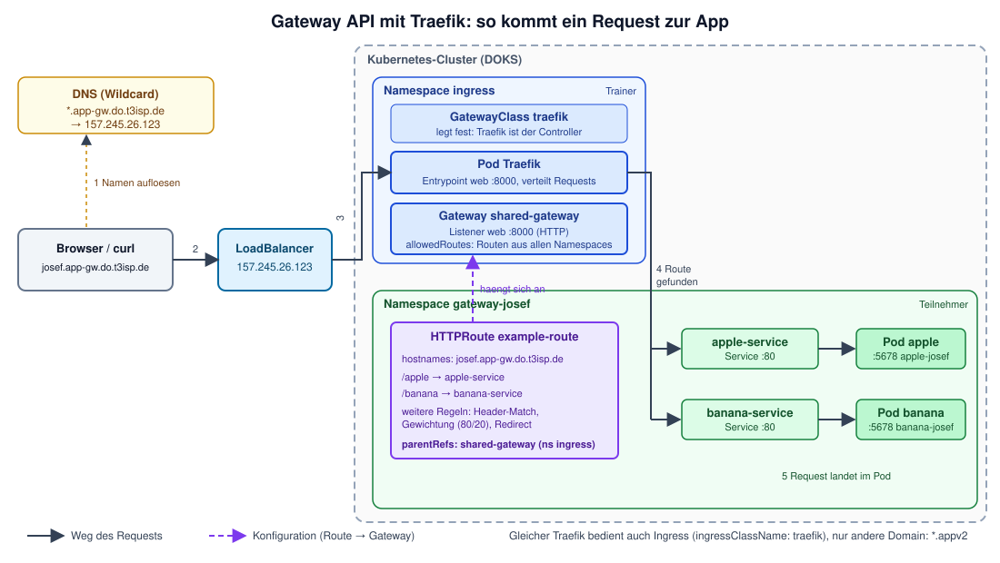

# Gateway API mit Traefik (Ergaenzung zu Ingress)

## Hintergrund



Die Gateway API ist der Nachfolger von Ingress. Statt einer Ressource gibt es drei, mit getrennten Rollen:

| Ressource | Pflegt | Aufgabe |
|-----------|--------|---------|
| GatewayClass | Infrastruktur | welcher Controller (hier: Traefik) |
| Gateway | Trainer | Listener: Port, Protokoll, welche Namespaces anhaengen duerfen |
| HTTPRoute | Teilnehmer | Hostnamen, Pfade, Backends, Gewichtung |

Gut zu wissen:

* **Ein Traefik fuer beides:** Derselbe Pod bedient Ingress und Gateway API, mit derselben LoadBalancer-IP.
  Getrennt werden die Uebungen nur ueber die Domain: Ingress `*.appv2.do.t3isp.de`, Gateway API `*.app-gw.do.t3isp.de`.
* **Gateway = nur Konfiguration:** Bei Traefik startet ein Gateway keinen eigenen Pod. Traefik liest die Gateways und
  Routen und oeffnet die passenden Listener.
* **Mehr Standard:** Header-Match, Gewichtung (Canary) und Redirects gehoeren zur API, keine controller-spezifischen Annotations.

Das Gateway `shared-gateway` hat der Trainer schon angelegt, siehe
[Trainer-Vorbereitung](05a-gateway-api-traefik-trainer-setup.md). Ihr braucht nur eine HTTPRoute.

## Schritt 1: Vorbereitung

Traegt zuerst euren Namen als Variable ein (klein, ohne Leerzeichen und Umlaute). Alle weiteren Befehle
verwenden diese Variable und koennen 1:1 kopiert werden.

```
NAME=josef
```

Wichtig: Die Variable gilt nur in dieser Terminal-Sitzung. Bei einem neuen Terminal bitte erneut setzen.

```
cd
mkdir -p manifests
cd manifests
mkdir -p gateway
cd gateway
kubectl create namespace gateway-$NAME
```

## Schritt 2: Anwendungen und Services

```
cat > 01-apple.yml <<EOF
apiVersion: apps/v1
kind: Deployment
metadata:
  name: apple-app
spec:
  replicas: 1
  selector:
    matchLabels:
      app: apple
  template:
    metadata:
      labels:
        app: apple
    spec:
      containers:
        - name: web
          image: hashicorp/http-echo
          args:
            - "-text=apple-$NAME"
---
apiVersion: v1
kind: Service
metadata:
  name: apple-service
spec:
  selector:
    app: apple
  ports:
    - port: 80
      targetPort: 5678
EOF
```

```
cat > 02-banana.yml <<EOF
apiVersion: apps/v1
kind: Deployment
metadata:
  name: banana-app
spec:
  replicas: 1
  selector:
    matchLabels:
      app: banana
  template:
    metadata:
      labels:
        app: banana
    spec:
      containers:
        - name: web
          image: hashicorp/http-echo
          args:
            - "-text=banana-$NAME"
---
apiVersion: v1
kind: Service
metadata:
  name: banana-service
spec:
  selector:
    app: banana
  ports:
    - port: 80
      targetPort: 5678
EOF
```

```
kubectl apply -f . -n gateway-$NAME
kubectl get pods,svc -n gateway-$NAME
```

Kurz warten, bis beide Pods `Running` sind, sonst kommt bei den ersten Requests `no available server`.

## Schritt 3: HTTPRoute mit Pfaden

```
cat > 03-httproute.yml <<EOF
apiVersion: gateway.networking.k8s.io/v1
kind: HTTPRoute
metadata:
  name: example-route
spec:
  parentRefs:
    - name: shared-gateway
      namespace: ingress
  hostnames:
    - "$NAME.app-gw.do.t3isp.de"
  rules:
    - matches:
        - path:
            type: PathPrefix
            value: /apple
      backendRefs:
        - name: apple-service
          port: 80
    - matches:
        - path:
            type: PathPrefix
            value: /banana
      backendRefs:
        - name: banana-service
          port: 80
EOF
```

```
kubectl apply -f . -n gateway-$NAME
kubectl get httproute -n gateway-$NAME
kubectl describe httproute example-route -n gateway-$NAME
```

In `describe` unter `Status > Parents` muessen die Conditions `Accepted` und `ResolvedRefs` auf `True` stehen.

## Schritt 4: Testen

```
curl http://$NAME.app-gw.do.t3isp.de/apple
curl http://$NAME.app-gw.do.t3isp.de/banana
curl http://$NAME.app-gw.do.t3isp.de/apple/foo
```

## Schritt 5: Header-Match

Nur wenn der Header `X-Version: 2` gesetzt ist, soll banana antworten, sonst apple.
Wir ueberschreiben dazu die Datei `03-httproute.yml` komplett.

```
cat > 03-httproute.yml <<EOF
apiVersion: gateway.networking.k8s.io/v1
kind: HTTPRoute
metadata:
  name: example-route
spec:
  parentRefs:
    - name: shared-gateway
      namespace: ingress
  hostnames:
    - "$NAME.app-gw.do.t3isp.de"
  rules:
    - matches:
        - headers:
            - name: X-Version
              value: "2"
      backendRefs:
        - name: banana-service
          port: 80
    - backendRefs:
        - name: apple-service
          port: 80
EOF
```

```
kubectl apply -f . -n gateway-$NAME
curl http://$NAME.app-gw.do.t3isp.de/
curl -H "X-Version: 2" http://$NAME.app-gw.do.t3isp.de/
```

Hinweis: Direkt nach dem `apply` kann der erste Request kurz `404 page not found` liefern, bis Traefik die Route
uebernommen hat. Dann einfach nach 2-3 Sekunden wiederholen.

## Schritt 6: Traffic-Splitting (Canary) per Gewichtung

Das geht mit Ingress nur ueber controller-spezifische Annotations, mit der Gateway API ist es Standard.
Wieder wird die Datei komplett ueberschrieben.

```
cat > 03-httproute.yml <<EOF
apiVersion: gateway.networking.k8s.io/v1
kind: HTTPRoute
metadata:
  name: example-route
spec:
  parentRefs:
    - name: shared-gateway
      namespace: ingress
  hostnames:
    - "$NAME.app-gw.do.t3isp.de"
  rules:
    - backendRefs:
        - name: apple-service
          port: 80
          weight: 80
        - name: banana-service
          port: 80
          weight: 20
EOF
```

```
kubectl apply -f . -n gateway-$NAME
for i in $(seq 1 20); do curl -s http://$NAME.app-gw.do.t3isp.de/; done | sort | uniq -c
```

Erwartet: ca. 80 % apple, 20 % banana (bei 20 Requests nur grob).

## Schritt 7: Fehlersuche (Route wird nicht angenommen)

```
kubectl describe httproute example-route -n gateway-$NAME
```

Typische Ursachen:

| Symptom | Ursache |
|---------|---------|
| `Accepted: False, NotAllowedByListeners` | Gateway erlaubt den Namespace nicht (`allowedRoutes`) |
| `ResolvedRefs: False, BackendNotFound` | Service-Name oder Port falsch, Request liefert `500` |
| `404 page not found` von Traefik, Status trotzdem `Accepted: True` | `parentRefs` zeigt auf ein nicht existierendes Gateway (Traefik meldet das nicht, die Route wird einfach ignoriert) oder der Hostname im Request passt nicht zu `hostnames` |
| `no available server` | Pods noch nicht bereit |

## Ingress vs. Gateway API

| Ingress | Gateway API |
|---------|-------------|
| `Ingress` (eine Ressource) | `GatewayClass` + `Gateway` + `HTTPRoute` |
| `ingressClassName: traefik` | `parentRefs` -> Gateway |
| `host` + `paths` | `hostnames` + `matches` |
| Gewichtung/Header nur per Annotation | `weight`, `headers` im Standard |
| nur HTTP(S) | zusaetzlich TCPRoute, GRPCRoute, TLSRoute |

## Aufraeumen

```
kubectl delete namespace gateway-$NAME
```

## Referenz

  * https://gateway-api.sigs.k8s.io/
  * https://doc.traefik.io/traefik/reference/routing-configuration/kubernetes/gateway-api/
