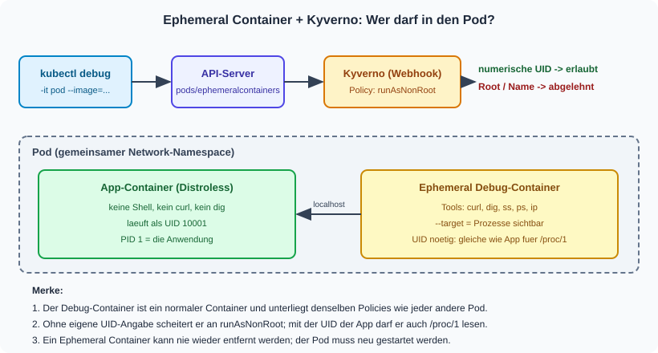

# Debugging: Ephemeral Container und Kyverno (runAsNonRoot)

## Hintergrund

Viele Anwendungen laufen auf schlanken Images (distroless, scratch). Dort gibt es
keine Shell, kein `curl`, kein `dig`:

```
kubectl exec <pod> -- sh
# -> executable file not found in $PATH
```

Mit einem **Ephemeral Container** haengt man zur Laufzeit einen zusaetzlichen
Debug-Container in einen **laufenden** Pod, ohne ihn neu zu starten oder neu
zu deployen. Der Debug-Container teilt sich das Netzwerk mit dem Pod
(`localhost` funktioniert) und sieht mit `--target` auch die Prozesse der App.



In vielen Clustern erzwingt eine Kyverno-Policy, dass alle Container als
Nicht-Root laufen (`runAsNonRoot: true`). Diese Policy gilt auch fuer den
Debug-Container, denn der Ephemeral Container wird ueber die Subresource
`pods/ephemeralcontainers` angelegt und von Kyverno geprueft.

| Szenario | Ergebnis |
|----------|----------|
| `kubectl debug` ohne weitere Angaben (Root-Image) | Von Kyverno abgelehnt |
| `--profile=restricted`, aber Image startet als root | Kyverno ok, aber `CreateContainerConfigError` im Kubelet |
| `--profile=restricted` + UID **anders** als die App | Startet, aber `/proc/1/environ` und `/proc/1/root` gehen nicht |
| `--profile=restricted` + **gleiche UID wie die App** | Alles geht |

## Voraussetzung (Trainer)

Kyverno muss im Cluster installiert sein. Falls nicht, als Trainer einmalig:

```
helm repo add kyverno https://kyverno.github.io/kyverno/
helm repo update
helm install kyverno kyverno/kyverno --version 3.7.2 -n kyverno --create-namespace \
  --set global.image.registry=ghcr.io
kubectl get pods -n kyverno
```

Hinweis: Ab Kyverno 1.20 werden `kyverno.io/v1` `Policy` und `ClusterPolicy` nicht
mehr angenommen. Diese Uebung nutzt deshalb Kyverno 1.17 (Chart 3.7.2).

`global.image.registry=ghcr.io` holt die Images von GitHub statt von `reg.kyverno.io`
(die Registry war beim Test zeitweise nicht erreichbar, 502/503).

Alle Pods in `kyverno` muessen `Running` sein.

## Schritt 1: Vorbereitung

```
cd
mkdir -p manifests
cd manifests
mkdir 25-debug-ephemeral-container-kyverno
cd 25-debug-ephemeral-container-kyverno
```

```
kubectl create namespace kyverno-debug-<dein-name>
```

## Schritt 2: Kyverno-Policy anlegen

Die Policy gilt nur in eurem Namespace (`Policy`, nicht `ClusterPolicy`).

```
# vi 01-policy.yml
apiVersion: kyverno.io/v1
kind: Policy
metadata:
  name: require-run-as-nonroot
spec:
  validationFailureAction: Enforce
  background: false
  rules:
    - name: run-as-non-root
      match:
        any:
          - resources:
              kinds:
                - Pod
                - Pod/ephemeralcontainers
      validate:
        message: "Alle Container (auch Ephemeral Container) muessen runAsNonRoot: true setzen."
        pattern:
          spec:
            containers:
              - securityContext:
                  runAsNonRoot: true
            =(ephemeralContainers):
              - securityContext:
                  runAsNonRoot: true
```

Wichtig ist `Pod/ephemeralcontainers` unter `kinds`. Ohne diese Zeile greift die Policy
nicht beim Anhaengen eines Debug-Containers.

```
kubectl apply -f 01-policy.yml -n kyverno-debug-<dein-name>
kubectl get policy -n kyverno-debug-<dein-name>
```

Es sollte `READY: True` angezeigt werden.

## Schritt 3: Anwendung ohne Shell deployen

Die App ist ein statisches Go-Binary (`FROM scratch`): keine Shell, keine Tools.
Sie laeuft mit der **UID 10001**. Das Passwort ist nur ein Uebungswert.

```
# vi 02-deployment.yml
apiVersion: apps/v1
kind: Deployment
metadata:
  name: app
spec:
  replicas: 1
  selector:
    matchLabels:
      app: app
  template:
    metadata:
      labels:
        app: app
    spec:
      containers:
        - name: app
          image: hashicorp/http-echo:1.0
          args:
            - "-text=hallo aus dem Pod"
          ports:
            - containerPort: 5678
          env:
            - name: DB_PASSWORD
              value: geheim123
          securityContext:
            runAsNonRoot: true
            runAsUser: 10001
            allowPrivilegeEscalation: false
            capabilities:
              drop: ["ALL"]
            seccompProfile:
              type: RuntimeDefault
```

```
kubectl apply -f 02-deployment.yml -n kyverno-debug-<dein-name>
kubectl rollout status deploy/app -n kyverno-debug-<dein-name>
kubectl get pods -n kyverno-debug-<dein-name>
```

Eine Shell gibt es nicht:

```
POD=$(kubectl get pod -n kyverno-debug-<dein-name> -l app=app -o jsonpath='{.items[0].metadata.name}')
kubectl exec -n kyverno-debug-<dein-name> $POD -- sh
```

**Erwarteter Fehler:**
```
exec: "sh": executable file not found in $PATH
```

## Schritt 4: Debug-Container ohne Profil - von Kyverno abgelehnt

`nicolaka/netshoot` ist ein Debug-Image mit `curl`, `dig`, `ss`, `ps` und mehr. Es startet
als root.

```
kubectl debug -n kyverno-debug-<dein-name> $POD -it --image=nicolaka/netshoot --target=app -- sh
```

**Erwarteter Fehler:**
```
resource Pod/kyverno-debug-<dein-name>/app-... was blocked due to the following policies

require-run-as-nonroot:
  run-as-non-root: 'validation error: Alle Container (auch Ephemeral Container) muessen
    runAsNonRoot: true setzen. rule run-as-non-root failed at path /spec/ephemeralContainers/0/securityContext/runAsNonRoot/'
```

## Schritt 5: Profil restricted - Kyverno ok, aber Kubelet lehnt ab

Das Profil `restricted` (kubectl ab 1.31) setzt `runAsNonRoot: true`. Damit besteht der
Container die Policy. Das Image startet aber als root:

```
kubectl debug -n kyverno-debug-<dein-name> $POD -it --image=nicolaka/netshoot --target=app \
  --profile=restricted --container=dbg-restricted -- id
```

Der Befehl haengt. In einem zweiten Terminal (oder mit Strg+C abbrechen):

```
kubectl get pod $POD -n kyverno-debug-<dein-name> \
  -o jsonpath='{range .status.ephemeralContainerStatuses[*]}{.name}{" -> "}{.state}{"\n"}{end}'
```

**Erwartete Ausgabe:**
```
dbg-restricted -> {"waiting":{"message":"container has runAsNonRoot and image has non-numeric user (root), cannot verify user is non-root ...","reason":"CreateContainerConfigError"}}
```

Der Kubelet kann bei `runAsNonRoot` nur mit einer **numerischen UID** pruefen. Ein Image mit
`USER root` oder `USER tekton` (Name statt Zahl) scheitert. Eigene Debug-Images
deshalb immer mit numerischem User bauen, z.B. `USER 999`.

Ein Ephemeral Container laesst sich nicht mehr entfernen. Er bleibt im Pod, bis der Pod
ersetzt wird.

## Schritt 6: Debug-Container mit eigener UID - es klappt

Die UID wird per `--custom` angegeben (kubectl ab 1.31):

```
# vi debug.json
{"securityContext": {"runAsUser": 10001, "runAsNonRoot": true}}
```

```
kubectl debug -n kyverno-debug-<dein-name> $POD -it --image=nicolaka/netshoot --target=app \
  --profile=restricted --custom=debug.json --container=dbg-uid -- sh
```

Im Debug-Container:

```
id -u
ps -ef
curl localhost:5678
cat /proc/1/environ | tr "\0" "\n" | grep DB_
ls /proc/1/root/
exit
```

**Erwartet:**
- `id -u` zeigt `10001`
- `ps -ef` zeigt `/http-echo ...` als PID 1 (wegen `--target=app`)
- `curl` zeigt `hallo aus dem Pod`
- `/proc/1/environ` ist lesbar, `DB_PASSWORD` taucht auf
- `/proc/1/root/` ist lesbar

Beachte: `printenv DB_PASSWORD` im Debug-Container zeigt **nichts**. Der Debug-Container hat
seine eigene Umgebung. Die Variablen der App sieht man nur ueber `/proc/1/environ`.

## Schritt 7: Andere UID - /proc/1 bleibt gesperrt

Jetzt ein Debug-Container mit einer anderen UID, so wie ein Image mit `USER 999`:

```
# vi debug-999.json
{"securityContext": {"runAsUser": 999, "runAsNonRoot": true}}
```

```
kubectl debug -n kyverno-debug-<dein-name> $POD -it --image=nicolaka/netshoot --target=app \
  --profile=restricted --custom=debug-999.json --container=dbg-999 -- sh
```

```
id -u
curl localhost:5678
ps -ef
cat /proc/1/environ | tr "\0" "\n" | grep DB_
ls /proc/1/root/
exit
```

**Erwartet:**
- `curl` und `ps -ef` funktionieren (Netzwerk und Prozessliste brauchen keine gleiche UID)
- `cat /proc/1/environ` meldet `Permission denied`, `grep` findet keine Variablen
- `ls /proc/1/root/` meldet `Permission denied`

Das ist **kein Kyverno-Problem**, sondern Linux: `/proc/<pid>/environ` und
`/proc/<pid>/root` darf nur lesen, wer dieselbe UID hat (oder `CAP_SYS_PTRACE`). Wer
`/proc/1/...` braucht, startet den Debug-Container mit der UID der Anwendung.

## Schritt 8: kubectl debug --copy-to

Mit `--copy-to` wird nicht der laufende Pod veraendert, sondern eine Kopie angelegt, in der
der Debug-Container ein normaler Container ist.

Standardprofil:

```
kubectl debug -n kyverno-debug-<dein-name> $POD --copy-to=app-debug1 \
  --image=nicolaka/netshoot --container=dbgcopy -- sleep 600
```

**Erwarteter Fehler:**
```
resource Pod/kyverno-debug-<dein-name>/app-debug1 was blocked due to the following policies

require-run-as-nonroot:
  run-as-non-root: 'validation error: ... failed at path /spec/containers/1/securityContext/runAsNonRoot/'
```

Das Standardprofil setzt keinen `securityContext`. Mit `restricted` und der UID klappt es:

```
kubectl debug -n kyverno-debug-<dein-name> $POD --copy-to=app-debug2 \
  --profile=restricted --custom=debug.json --share-processes \
  --image=nicolaka/netshoot --container=dbgcopy2 -- sleep 600
```

```
kubectl get pods -n kyverno-debug-<dein-name>
```

**Erwartet:** `app-debug2` mit `2/2 Running`.

## Aufraeumen

```
kubectl delete namespace kyverno-debug-<dein-name>
```

Trainer, nach der Uebung: Kyverno wieder entfernen.

```
helm uninstall kyverno -n kyverno
kubectl delete namespace kyverno
```

## Zusammenfassung

| Befehl | Ergebnis |
|--------|----------|
| `kubectl debug ... --image=netshoot` | Abgelehnt von Kyverno (kein `runAsNonRoot`) |
| `... --profile=restricted` (Image startet als root) | `CreateContainerConfigError` (nicht-numerischer User) |
| `... --profile=restricted --custom=debug.json` (UID wie App) | Alles geht, auch `/proc/1/environ` |
| `... --custom=debug-999.json` (andere UID) | `curl`/`ps` gehen, `/proc/1/...` gesperrt |
| `--copy-to` mit Standardprofil | Abgelehnt von Kyverno |
| `--copy-to --profile=restricted --custom=...` | Funktioniert |
