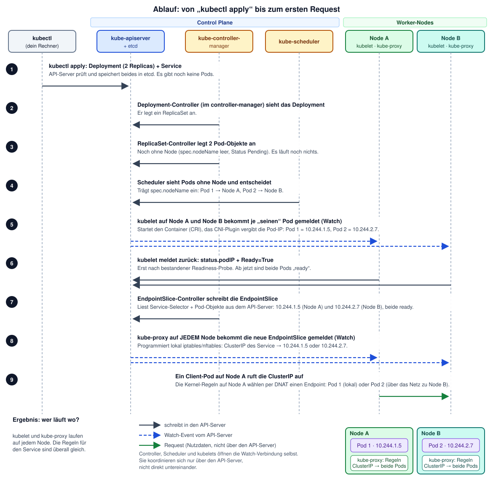
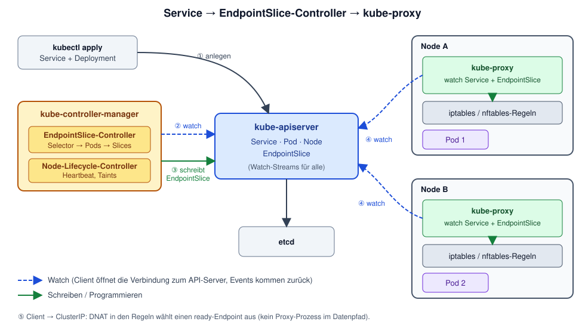
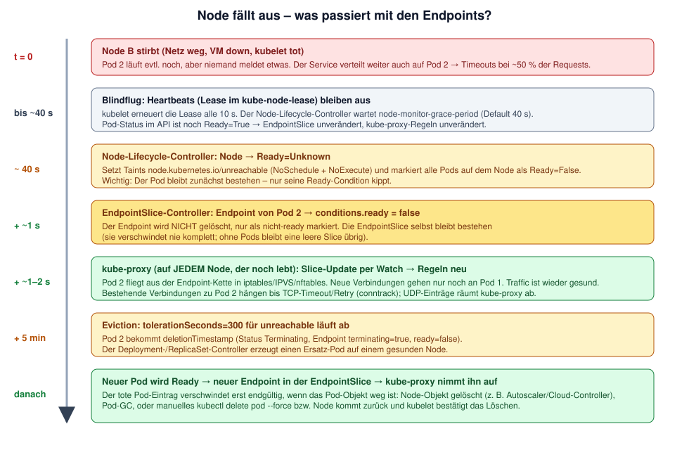

# Service → EndpointSlice-Controller → kube-proxy

Wie ein Service-Request im Cluster tatsächlich bei einem Pod landet – und was passiert, wenn ein Node ausfällt.

## 0. Der Ablauf Schritt für Schritt

Von `kubectl apply` bis zum ersten Request, mit den beteiligten Komponenten und dem Node, auf dem jeder Pod landet:



## 1. Das Zusammenspiel



| Komponente | Läuft wo | Aufgabe |
|---|---|---|
| **Service** | nur ein Objekt in der API (etcd) | Stabile virtuelle IP (ClusterIP) + Selector. Enthält selbst **keine** Pod-IPs. |
| **EndpointSlice-Controller** | `kube-controller-manager` | Beobachtet Services und Pods. Legt zu jedem Service mit Selector EndpointSlices an (max. 100 Endpoints pro Slice) und hält sie aktuell. Pro Endpoint: Pod-IP, Node, Conditions `ready` / `serving` / `terminating`. |
| **kube-proxy** | DaemonSet, auf **jedem** Node | Beobachtet Services + EndpointSlices per Watch und programmiert daraus lokale Regeln (iptables oder nftables; der IPVS-Modus ist deprecated, KEP-5495). |

Ablauf:

1. Du legst Deployment + Service an. Die API speichert beides in etcd.
2. Der EndpointSlice-Controller sieht den neuen Service und die passenden Pods (per Watch).
3. Er schreibt die EndpointSlice(s) mit allen **ready** Pod-IPs.
4. kube-proxy auf jedem Node sieht die neue/geänderte Slice und baut seine Regeln um.
5. Ein Client spricht die ClusterIP an. Die Regeln im Kernel (DNAT) wählen einen Endpoint aus. kube-proxy ist **nicht** im Datenpfad, er konfiguriert nur.

> Der Service-Controller (Name im Titel „ServiceController“) ist etwas anderes: Der kümmert sich nur um `type: LoadBalancer` (Cloud-Loadbalancer anlegen). Für ClusterIP/Endpoints ist der **EndpointSlice-Controller** zuständig.

## 2. Node fällt aus – was passiert?



### Was sind die „Heartbeats“ des Kubelets?

Der Kubelet meldet sich auf zwei Wegen beim API-Server:

| | Lease | Node-Status |
|---|---|---|
| **Objekt** | `Lease` (`coordination.k8s.io/v1`) im Namespace `kube-node-lease`, Name = Node-Name | `Node`-Objekt, Subresource `status` |
| **Call** | `GET`, bei Bedarf `CREATE`, dann `UPDATE` (PUT) auf `/apis/coordination.k8s.io/v1/namespaces/kube-node-lease/leases/<node>` | `PATCH /api/v1/nodes/<node>/status` |
| **Inhalt** | im Wesentlichen `spec.renewTime`, dazu `leaseDurationSeconds: 40` | Conditions (Ready, MemoryPressure, DiskPressure, PIDPressure), Kapazität/Allocatable, Adressen, Node-Info, Images |
| **Takt** | alle 10 s (0,25 × 40 s) | Prüfung alle 10 s, gepatcht wird nur bei Änderung oder nach `NodeStatusReportFrequency` (Default 5 min) |
| **Zweck** | billiger Heartbeat (winziges Objekt) | vollständiger Zustand des Nodes |

Bleiben die Updates aus, läuft beim Node-Lifecycle-Controller die `node-monitor-grace-period` (50 s) ab, und der Node wird `Ready=Unknown`. Ob der Controller genau Lease und Status kombiniert auswertet, ist hier nicht im Code geprüft.

### Welche Controller sind beteiligt?

„Node-Controller“ aus älteren Büchern und Docs ist heute auf mehrere Controller aufgeteilt:

| Controller | Läuft in | Aufgabe beim Node-Ausfall |
|---|---|---|
| **Node-Lifecycle-Controller** (`pkg/controller/nodelifecycle`) | kube-controller-manager | Erkennt fehlende Lease/Heartbeat, setzt Node `Ready=Unknown`, setzt die Taints `unreachable`/`not-ready` und markiert die Pods des Nodes als nicht ready. |
| **Taint-Eviction-Controller** (`pkg/controller/tainteviction`) | kube-controller-manager | Löscht Pods (`Pod.Delete`), wenn `tolerationSeconds` für einen `NoExecute`-Taint abgelaufen ist (Default 300 s). |
| **EndpointSlice-Controller** | kube-controller-manager | Setzt `ready=false` bzw. `terminating=true` am Endpoint, entfernt ihn, sobald das Pod-Objekt weg ist. |
| **Cloud-Node-Lifecycle-Controller** | cloud-controller-manager | Nur bei Cloud-Providern (z. B. DOKS): löscht das Node-Objekt, wenn die VM nicht mehr existiert. Danach räumt der Pod-GC die Pods ab (früher als 5 min). |
| **Node-IPAM-Controller** | kube-controller-manager | Verteilt Pod-CIDRs, hat mit dem Ausfall nichts zu tun. |

### Historie: vom „Node-Controller“ zu mehreren Controllern

Früher gab es einen einzigen **Node-Controller** (`pkg/controller/node`). Er machte CIDR-Verwaltung, Überwachung des Node-Status und Pod-Eviction in einem Prozess und löschte außerdem Nodes, die beim Cloud-Provider nicht mehr existieren. Aufgeteilt wurde er schrittweise:

| Zeitpunkt | Änderung | Beleg |
|---|---|---|
| 2017-10 | Split in **Node-Lifecycle-** und **Node-IPAM-Controller**. Motivation laut Commit: Cloud-Provider-Abhängigkeit aus dem Node-Controller entfernen. | Commit `9187b343e` in kubernetes/kubernetes |
| 2018-10 | Löschlogik für Nodes, die in der Cloud nicht mehr existieren, zwischen Node-Lifecycle- und Cloud-Node-Controller zusammengeführt. | Commit `5329f0966` |
| 2020-05 | Cloud-Node-Lifecycle-Controller nach `k8s.io/cloud-provider` verschoben, damit externe Cloud-Provider ihn nutzen können. | Commit `41dc075a8` |
| 2023-07 | **Taint-Eviction-Controller** aus dem Node-Lifecycle-Controller herausgelöst (vorher „TaintManager“). Beta v1.29, Stable v1.34. Ziel: Separation of Concerns, Wartbarkeit, austauschbare Eviction. | KEP-3902, Commit `ccda2d6fd` |

Die Cloud-Aufgaben des alten Node-Controllers beschreibt KEP-2392 (cloud-controller-manager). Quellen: `kubernetes/kubernetes` (Git-Verlauf) und `kubernetes/enhancements` (KEP-2392, KEP-3902).

### Korrektur zur Annahme „EndpointSlice verschwindet“

Die EndpointSlice **verschwindet nicht**, wenn ein Node ausfällt. Es ändert sich der **Endpoint-Eintrag darin**:

| Zeitpunkt | Zustand des Endpoints von Pod 2 | Wirkung |
|---|---|---|
| Node stirbt bis ~50 s | `ready: true` (API weiß noch nichts) | Requests an Pod 2 laufen in Timeouts |
| ab ~50 s | `ready: false` | kube-proxy entfernt Pod 2 aus den Regeln, Traffic wieder gesund |
| ab ~5 min 50 s | `terminating: true`, `ready: false` | Pod wird evicted, Ersatz-Pod startet anderswo |
| Pod-Objekt endgültig weg | Eintrag aus der Slice entfernt | Slice enthält nur noch die gesunden Pods |

Die Slice an sich wird nur gelöscht, wenn der Service gelöscht wird (oder der Controller überzählige Slices zusammenführt). Hat ein Service gar keine Endpoints mehr, bleibt eine **leere** Slice bestehen.

### Was kube-proxy dabei tut

- Er reagiert **nur auf die Änderung in der EndpointSlice**. Er prüft die Nodes oder Pods nicht selbst.
- Sobald `ready=false` ankommt (typisch 1–2 s später), wird der Endpoint aus der Regelkette entfernt.
- Hat ein Service **keinen** ready Endpoint mehr, installiert kube-proxy eine REJECT-Regel: Clients bekommen sofort „Connection refused“ statt eines Timeouts.
- Bestehende TCP-Verbindungen zum toten Pod hängen, bis Retries/Timeouts greifen (conntrack). Das ist eine Eigenheit des Datenpfads, kein kube-proxy-Fehler.

### Konsequenzen für die Praxis

- **Die ~50 s Blindflug sind der teure Teil.** Readiness-Probes helfen hier nicht, weil sie vom kubelet auf dem toten Node ausgeführt werden. Die Verkleinerung geht über `node-monitor-grace-period` (Control-Plane) oder schnellere Heartbeats, hat aber Nebenwirkungen (Flapping).
- **Clients brauchen Timeouts und Retries.** Sonst hängen Requests in den ersten 50 s.
- **`tolerationSeconds` anpassen**, wenn 5 min bis zum Ersatz-Pod zu lang sind (z. B. 30–60 s für zustandslose Apps).
- **Mehrere Replicas auf verschiedenen Nodes** (topologySpreadConstraints / Anti-Affinity), sonst gibt es nach dem Ausfall keinen gesunden Endpoint.
- **StatefulSets:** Das Pod-Objekt des toten Nodes bleibt nach der Eviction im Status Terminating bestehen, solange das kubelet das Löschen nicht bestätigt. Solange es existiert, gibt es keinen Ersatz-Pod mit demselben Namen (Schutz vor zwei Pods mit gleicher Identität). Nötig ist manuelles Eingreifen: `kubectl delete pod --force`, Node-Objekt löschen oder Taint `node.kubernetes.io/out-of-service` setzen (dann räumt der Pod-GC-Controller die Terminating-Pods ab).


## 3. Beobachten in der Übung

```bash
# Service, Slice und Endpoints ansehen
kubectl get svc,endpointslice -l kubernetes.io/service-name=<svc-name>
kubectl get endpointslice <slice> -o yaml   # conditions.ready/serving/terminating

# Node-Ausfall beobachten (zweites Terminal)
kubectl get nodes -w
kubectl get endpointslice -l kubernetes.io/service-name=<svc-name> -o yaml -w

# Regeln auf dem Node ansehen (iptables-Modus)
sudo iptables-save -t nat | grep <svc-name>

# kube-proxy-Modus prüfen
kubectl -n kube-system get cm kube-proxy -o yaml | grep -i mode
```

Hinweis: Auf **DOKS** (Managed Kubernetes) ist die Control-Plane fremdverwaltet. Die Timeouts oben sind die Upstream-Defaults. Bei Cilium als CNI mit `kubeProxyReplacement` übernimmt Cilium die Rolle von kube-proxy, das Prinzip (Watch auf EndpointSlices) bleibt gleich.
