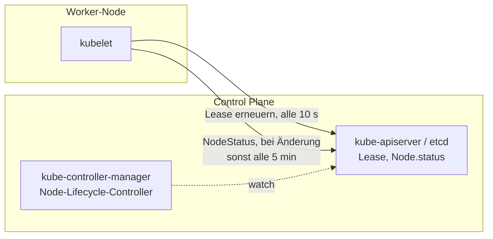
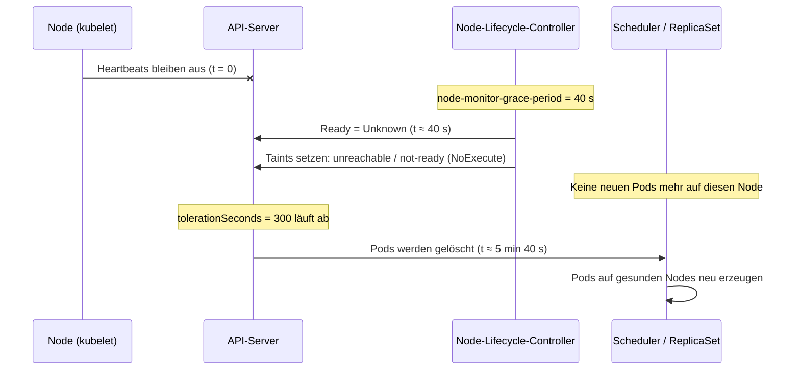

# Wie erkennt Kubernetes, dass ein Node ausgefallen ist?

Der Node meldet sich aktiv per **Heartbeat** beim Control Plane. Bleibt die Meldung aus, markiert der Control Plane ihn als nicht erreichbar, sperrt ihn per Taint und plant seine Pods auf anderen Nodes neu.

## Normalbetrieb: Heartbeats



Der kubelet sendet zwei Arten von Heartbeats:

| Heartbeat | Wo | Takt |
|-----------|----|------|
| **Lease** | Namespace `kube-node-lease` | ca. alle 10 s, sehr klein und billig |
| **NodeStatus** | `Node.status` (Conditions wie `Ready`, `MemoryPressure`, `DiskPressure`) | bei Änderung, sonst spätestens alle 5 min |

## Ablauf nach dem Ausfall



1. **t = 0:** Der Node fällt aus (kubelet, VM oder Netzwerk). Es kommt kein Lease-Update mehr an.
2. **t ≈ 40 s:** Die Grace Period (`--node-monitor-grace-period`, Standard 40 s) ist abgelaufen. Der Node-Lifecycle-Controller im `kube-controller-manager` setzt `Ready` auf `Unknown`. `kubectl get nodes` zeigt `NotReady`.
3. **Gleichzeitig:** Der Controller setzt die Taints
   - `node.kubernetes.io/unreachable:NoExecute`
   - `node.kubernetes.io/not-ready:NoExecute`
4. **Ab dem Taint:** Der Scheduler platziert keine neuen Pods mehr auf dem Node.
5. **t ≈ 5 min 40 s:** Jeder Pod hat automatisch eine Toleration für diese Taints mit `tolerationSeconds: 300`. Sie läuft 5 Minuten nach dem Taint ab. Dann werden die Pods gelöscht, und ReplicaSet bzw. Deployment erzeugen sie auf gesunden Nodes neu.

## Wichtige Details

- **StatefulSets** werden nicht automatisch verschoben. Kubernetes kann nicht wissen, ob der Pod noch läuft (Split-Brain-Gefahr). Hier hilft manuelles `kubectl delete pod --force` oder Node-Shutdown-Handling.
- Die Wartezeit lässt sich pro Pod mit einer eigenen Toleration und kürzerem `tolerationSeconds` verkürzen:

```yaml
tolerations:
  - key: node.kubernetes.io/unreachable
    operator: Exists
    effect: NoExecute
    tolerationSeconds: 30
  - key: node.kubernetes.io/not-ready
    operator: Exists
    effect: NoExecute
    tolerationSeconds: 30
```

- In **Managed-Clustern (z. B. DOKS)** erkennt zusätzlich der Cloud-Controller-Manager, wenn die VM beim Provider nicht mehr existiert, und entfernt den Node sofort. Die 5-Minuten-Wartezeit entfällt dann.

## Zum Nachvollziehen

```bash
# Heartbeats der Nodes ansehen
kubectl get lease -n kube-node-lease

# Conditions eines Nodes
kubectl describe node <node> | grep -A8 Conditions

# Taints eines Nodes
kubectl get node <node> -o jsonpath='{.spec.taints}'
```

Ausfall simulieren:

```bash
# auf dem Worker-Node
sudo systemctl stop kubelet

# in einem zweiten Terminal
kubectl get nodes -w
```

Nach ca. 40 s steht der Node auf `NotReady`, nach ca. 5 min 40 s werden die Pods neu geplant.
